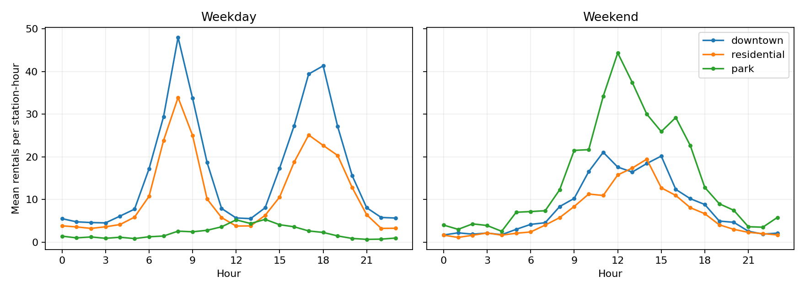
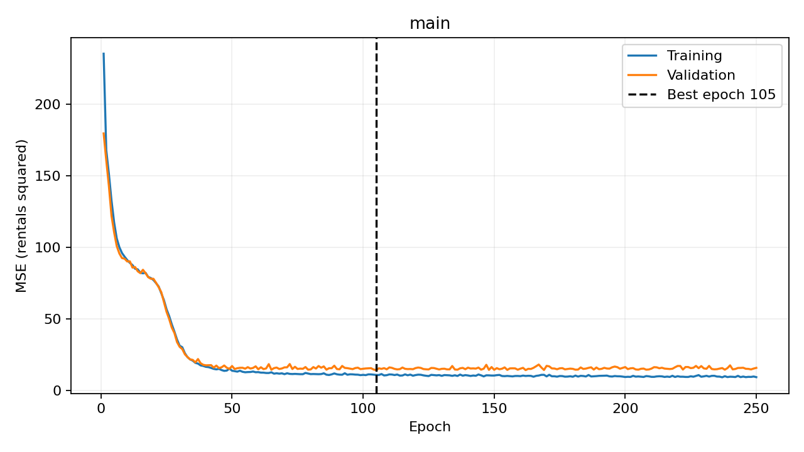
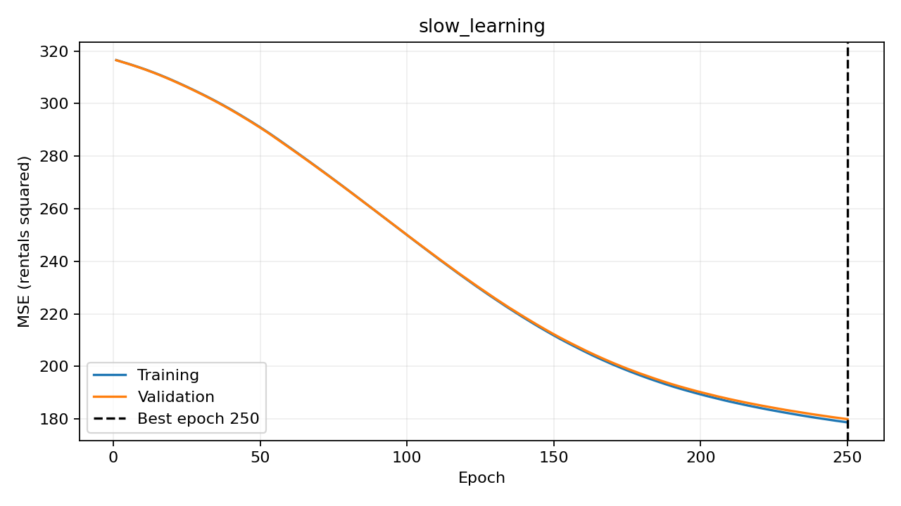
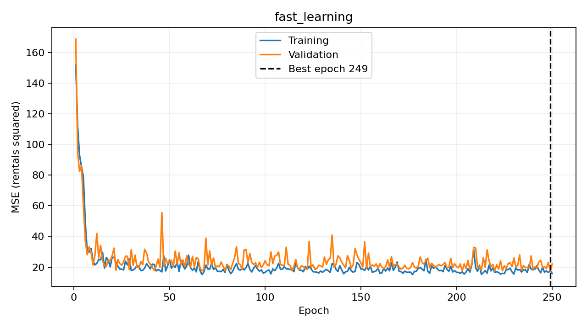

# Lakeshore Bike Demand

## What it does

This project predicts hourly bike rentals for a station from the hour, weather,
weekend status and station type. It compares a PyTorch neural network with a
training-mean predictor and linear regression, using a manually written training
loop. The estimates could help planners decide where to investigate demand before
moving bikes.

## How to run it

Use Python 3.12 and run these commands from the repository root:

```bash
git clone https://github.com/safi111287/lab07-first-principles.git
cd lab07-first-principles
conda env create -f environment.yml
conda activate lab07-first-principles
python bikes_data.py
python train.py
python -m ruff format --check .
python -m ruff check .
python -m pytest
```

If the environment already exists, update it with
`conda env update -n lab07-first-principles -f environment.yml`.
The environment installs `requirements-dev.txt`, which includes the runtime
requirements. Exact direct dependency versions are pinned. The PyTorch CPU wheel
is pinned explicitly and its package index is included in `requirements.txt`;
no CUDA installation or GPU is needed on Windows or Linux.

On Windows, use Anaconda Prompt or select **Command Prompt** from the VS Code
terminal menu before activating the environment. If needed, use:

```bat
conda.bat activate lab07-first-principles
python -c "import sys; print(sys.executable)"
```

The printed path must point to `envs/lab07-first-principles`. Selecting the
interpreter in VS Code does not necessarily activate an existing terminal.
If PowerShell blocks activation scripts, use Command Prompt instead.

If terminal activation selects a different Python, use the explicit environment:

```bash
conda run --no-capture-output -n lab07-first-principles python train.py
conda run -n lab07-first-principles python -m pytest
conda run -n lab07-first-principles python -m ruff format --check .
conda run -n lab07-first-principles python -m ruff check .
```

`python train.py` regenerates all files in `reports/`: three learning-curve PNGs,
three epoch-history CSVs, the experiment table, metrics JSON and the exploratory
hourly-demand PNG. Paths are resolved relative to the source files. Reports are
committed so the results can be read without running training. Test cases cover
the split, preparation, Dataset, loaders, network and loop, including gradient
clearing and restoration of the best weights.

## Data and split

`bikes_data.py` is the supplied, unchanged generator. It creates 6,000 synthetic
station-hour rows with seed 2026. The target is `rentals`; the six input columns
are `hour`, `temperature_c`, `rain_mm`, `wind_kph`, `is_weekend` and
`station_type`. The target is never included in the input features.

Two fixed-seed random splits produce 3,600 training rows, 1,200 validation rows
and 1,200 test rows, with disjoint original row indices. Splitting happens before
fitting the scaler or encoder. `StandardScaler` learns means and scales only from
the five numeric training columns. `OneHotEncoder(handle_unknown="ignore")`
learns station categories only from training rows; validation and test rows use
those fitted transformations. The resulting input width is eight. Unknown future
stations receive all-zero station indicators and are outside the training scope.

`RentalsDataset` returns a float32 feature vector of shape `(8,)` and target of
shape `(1,)`. A batch has shapes `(N, 8)` and `(N, 1)`, avoiding accidental
broadcasting in the loss. Only the training DataLoader shuffles. Its own seeded
generator makes the order repeatable, while validation and test keep their order.
The split is appropriate for the supplied independently generated table; it is
not evidence of generalization across real dates or unseen stations.

The exploratory plot uses training rows only. Weekday downtown and residential
demand have morning and evening peaks, while weekend park demand peaks around
midday. One straight-line relationship with hour cannot describe both peaks or
these station-by-weekend interactions.



## Model and training

The main network is `8 → 64 → ReLU → 32 → ReLU → 1`. The last layer is linear:
this is regression in rentals, not classification or a probability. Targets stay
in rental units. We optimize mean squared error (MSE) with Adam, learning rate
0.003, batches of 64 and 250 epochs. MAE is also measured in rentals.

`run_epoch()` calls `model.train()` with gradients when an optimizer is supplied;
otherwise it uses evaluation mode and disables gradients. Every training batch
visibly performs `optimizer.zero_grad()`, a forward pass, MSE calculation,
`loss.backward()` and `optimizer.step()`. Loss and absolute error are accumulated
by row count, so a short final batch has the correct weight.

`fit_network()` logs training MSE, training MAE, validation MSE and validation MAE
for every epoch. It copies the state dictionary whenever validation MSE improves
and restores that independent copy after training. The best epoch is selected by
validation MSE, not by the final epoch or the lowest MAE. Training loss is measured
while weights change within an epoch; validation loss is measured afterward with
fixed weights, so their values are not exactly like-for-like training-set scores.

Python, NumPy and PyTorch use seed 2026. Each run resets initialization and the
training DataLoader generator to that seed, uses CPU execution, one PyTorch thread
and deterministic algorithms. Experiments share the same splits and initial
architecture. Repeated runs on the same software and computer reproduce the
numbers. Different platforms can produce numerical differences and select different
best epochs; `metrics.json` records
the runtime package versions. Reference execution used Python 3.12.16,
torch 2.6.0+cpu, NumPy 2.3.5, pandas 2.2.3, scikit-learn 1.8.0 and
matplotlib 3.10.8.

## Results

Both baselines are fitted on training rows and use the same prepared features and
held-out rows as the network. The mean baseline always predicts the training
target mean, 10.603889 rentals. After all experiment settings and checkpoints were
chosen using validation data, the selected network and the two baselines were
each evaluated once on the test rows. Alternative neural networks were not scored
on the test set, and no settings were changed in response to the test result.

| Model | Validation MAE in rentals | Test MAE in rentals |
|---|---:|---:|
| Training mean | 9.951945 | 9.848395 |
| Linear regression | 9.032177 | 8.762954 |
| Neural network at restored epoch 238 | 2.571631 | 2.491182 |

The linear model improves slightly on a constant but still misses the curved
hourly peaks and interactions visible in the training-data plot. The network
learns these nonlinear patterns and has a substantially lower test MAE. An MAE
of 2.491182 means the average absolute error is about 2.49 rentals per
station-hour on this synthetic test set; it is not an accuracy percentage.
The selected network's test MSE is 13.355129 rentals squared.



The main run reaches its lowest validation MSE, 14.062705, at epoch 238.
At epoch 250, training MSE is 9.125448 and validation MSE is 15.312430.
The lower training loss and worse final validation loss show a generalization
gap and a reason to restore the best checkpoint rather than retain the final
weights. These endpoint values alone do not establish a sustained overfitting
trend. The restored epoch 238 is used for the final result.

## Experiments

Each additional run changes only the learning rate relative to the main run.
All use hidden widths `(64, 32)`, batch size 64, Adam and 250 epochs, with identical
splits and reset seeds. The final network is chosen by the lowest best-checkpoint
validation MSE across these three runs. The main run wins this comparison.

| Run | Learning rate | Best epoch by MSE | Lowest validation MAE during run | Validation MAE at restored best MSE | Final training MSE | Final validation MSE |
|---|---:|---:|---:|---:|---:|---:|
| Main | 0.003 | 238 | 2.484661 | 2.571631 | 9.125448 | 15.312430 |
| Slow learning | 1e-05 | 250 | 8.771483 | 9.135968 | 178.731081 | 179.955204 |
| Fast learning | 0.1 | 67 | 2.827001 | 2.856122 | 16.128429 | 22.588268 |

MSE is in rentals squared; MAE is in rentals. The lowest validation MAE and the
MAE at the minimum-MSE checkpoint can occur at different epochs, because MSE
penalizes large errors more strongly. The final-loss columns describe epoch 250,
before best-weight restoration. `experiments.csv` also records the best MSE.

**Main run:** It learns the main patterns and has the best validation MSE. Later
training does not guarantee a better validation score, and the final epoch
is worse than the restored checkpoint. This is the selected configuration.

**Slow learning:** At the same epoch budget, training and validation losses remain
high and close together. The loss is still decreasing at epoch 250. This is
underfitting from insufficient optimization progress at this learning rate,
rather than evidence that the architecture cannot represent the relationship.
It might improve with more epochs, but that was not tested.



**Fast learning:** Its best validation MSE is 17.588444 at epoch 67, worse than
14.062705 for the main run. At epoch 250, training MSE is 16.128429 and validation
MSE is 22.588268. Continuing training beyond the best checkpoint does not improve
the selected score. This is consistent with an excessive learning rate causing
updates that fail to settle reliably, although endpoint values alone cannot
separate instability from overfitting. The run still learns substantially more
than the very slow run; it is not a complete failure to learn.



## Limitations

These are invented rows from one fixed generator, not observations from an actual
bike-share system. The held-out rows share its assumptions and station categories;
the scores do not establish performance in another city, season or real station.
The model does not see holidays, events, available bikes, docking capacity,
station location, recent demand or forecast-weather uncertainty.

The output is a point estimate and can be fractional or negative because the
required final layer is linear. Metrics use raw predictions with no clipping or
rounding. A real operational system would need a justified treatment of negative
counts and uncertainty before deployment.

Three learning-rate settings with one seed are a limited experiment, not a full
hyperparameter search or an uncertainty estimate. There are no repeated-split
confidence intervals or assessments of rare conditions. Planners should not
automatically move bikes, assume enough stock exists, or treat a prediction as a
guaranteed rental count. Real data and operational constraints must be evaluated
before using this model for dispatch decisions.
